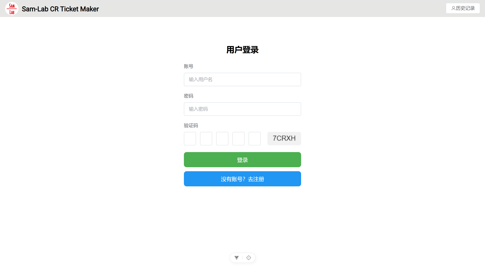
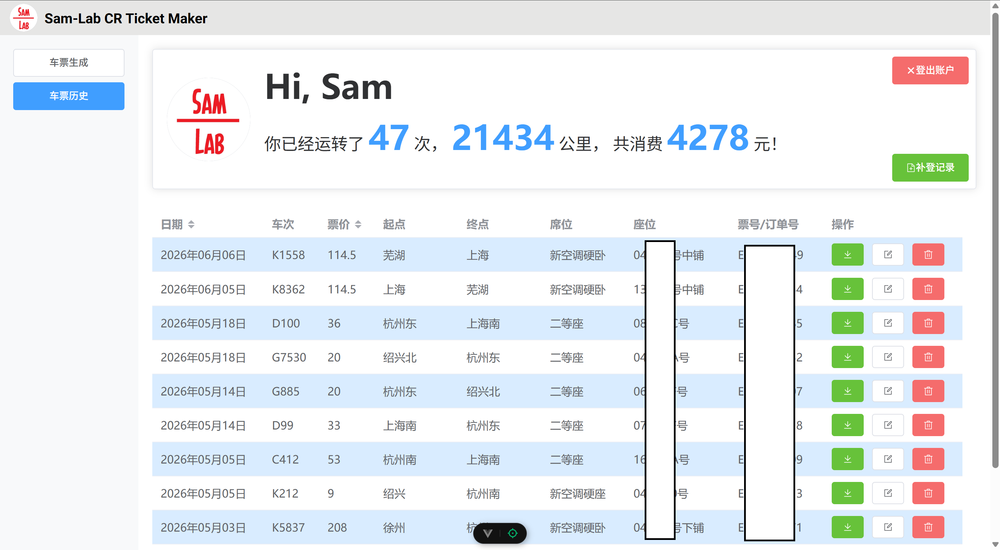
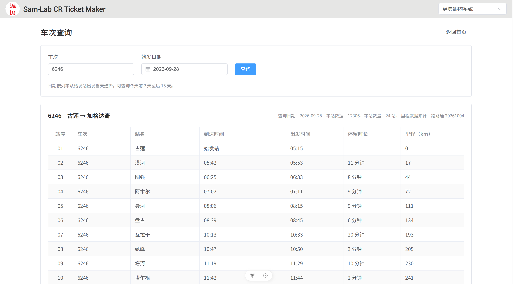

# CR Ticket Maker

用于生成 CR 样式车票的 Web 应用，支持车票导出、历史记录、余票监控、车次查询和车站大屏。

**生成的车票仅供展示，不能作为乘车凭证。**

## 在线演示

[打开网页版演示](https://sam28403.github.io)

演示站点仅提供静态车票生成功能。账户、历史记录、余票监控、车次查询和车站大屏需部署后端。

Android 客户端已独立维护，见 [CRTicket-Android](https://github.com/sam28403/CRTicket-Android)。

## 主要功能

- 自定义车票信息和背景，导出 PNG 或 PDF。
- 登录后保存、修改和下载历史车票，查看运转统计与地图。
- 查询余票，按车站、时间、车次和席别筛选并定时监控。
- 查询车次经停时刻、里程和线路图，浏览路路通离线车次列表。
- 查看当天车站到发大屏和车站地图。
- 支持亮色、暗色、高对比度主题，可自行部署运行。

## 快速启动

需要 Node.js `>=22.12.0`，推荐 `26.x`。

```bash
npm install
npm run dev:full
```

打开终端中显示的 Vite 地址，默认是 `http://localhost:5173`。
后端默认监听 `127.0.0.1:3000`，Vite 将 `/api` 请求代理到后端。
余票和时刻表等查询功能需要后端能够访问对应数据源。

也可分别运行 `npm run dev` 和 `node server/app.js`。

生产构建使用 `npm run build`，静态演示版使用 `npm run build:ghpages`。
完整部署方式见[构建与部署](docs/deployment.md)。

## 项目截图

<details>
<summary>展开网页版截图</summary>









</details>

## 车票生成样例


## 详细文档

- [Wiki 使用手册](https://github.com/sam28403/CRTicket/wiki/User-Guide)
- [Wiki 常见问题](https://github.com/sam28403/CRTicket/wiki/FAQ)
- [构建与部署](docs/deployment.md)
- [开发与项目结构](docs/development.md)
- [更新日志维护](docs/changelog.md)
- [历史记录备份互通](docs/backup-compatibility.md)
- [地图数据与坐标维护](docs/map-maintenance.md)
- [贡献指南](docs/contributing.md)
- [安全问题报告](SECURITY.md)

## 许可证

见 [LICENSE](LICENSE)。
